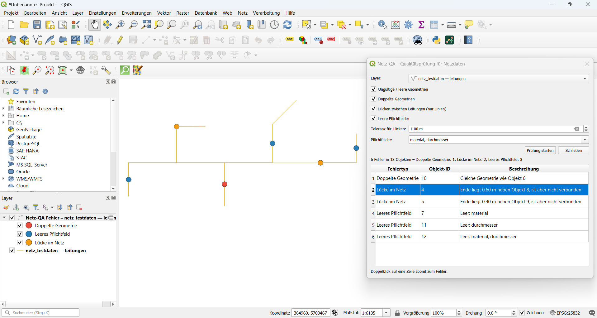
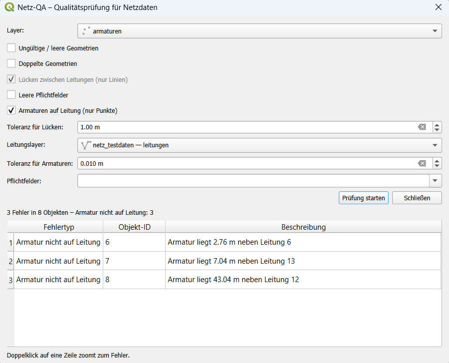
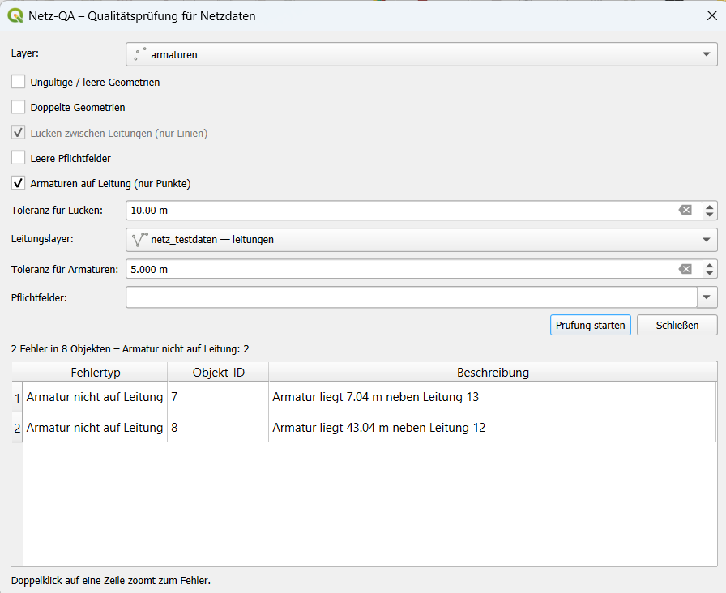

# QGIS Netz-QA – Quality Checks for Utility Network Data

[English](#qgis-netz-qa--quality-checks-for-utility-network-data) | [Deutsch](#deutsch)

**Netz-QA** is a QGIS plugin (Python / PyQGIS) that checks line and point layers of utility networks – water and gas pipes, cables, poles – for typical data errors with one click. All errors are listed in a table, shown as a coloured point layer on the map, and each error can be zoomed to with a double click.



---

## Checks

| Check | What it finds |
|---|---|
| **Invalid / empty geometries** | Features without geometry or with geometries that are invalid according to GEOS |
| **Duplicate geometries** | Two or more features with exactly the same geometry (e.g. a pipe digitised twice) |
| **Gaps in the network** (lines only) | Line ends that lie closer than a tolerance (e.g. 1 m) to another line but do not touch it – typical digitising errors. Real network ends further away are **not** reported. |
| **Empty required fields** | Features where selected attributes (e.g. material, diameter) are empty |
| **Valves not on a pipe** (points only) | Point features (valves, hydrants, nodes) that lie further than a tolerance (e.g. 0.01 m) from the nearest line of a selected pipe layer |

## Test result

The repository contains a test network (13 pipes in Essen, EPSG:25832) with built-in errors. Netz-QA found exactly the **6 expected errors** and no false positives:

| Error type | Count | Details |
|---|---|---|
| Duplicate geometry | 1 | Pipe 10 = copy of pipe 6 |
| Gap in the network | 2 | 0.60 m and 0.40 m |
| Empty required field | 3 | material and/or diameter missing |

**Point check:** a second test layer `testdata/armaturen.gpkg` contains 8 valves – 5 snapped exactly onto pipes and 3 placed next to them. With a tolerance of 0.01 m Netz-QA found exactly the **3 misplaced valves** (2.76 m, 7.04 m and 43.04 m away); with a tolerance of 5 m only the 2 valves further away were reported.





---

## Installation

1. Download this repository as ZIP (**Code → Download ZIP**) and unpack it
2. Zip only the folder `netz_qa` (so that the ZIP contains `netz_qa/…`)
3. QGIS → **Plugins → Manage and Install Plugins → Install from ZIP** → select the ZIP
4. A green Netz-QA icon appears in the toolbar and under **Vector → Netz-QA**

Requirements: QGIS 3.28 or newer (prepared for QGIS 4 / Qt6).

## Usage

1. Load a network layer (or `testdata/netz_testdaten.gpkg` and `testdata/armaturen.gpkg`)
2. Open Netz-QA, choose the layer, the checks, the gap tolerance and the required fields
   – for the point check: choose a point layer, the pipe layer and the valve tolerance
3. Click **Prüfung starten** (start check)
4. Double-click a row in the table to zoom to the error

---

## Technical details

- **PyQGIS**: QgsSpatialIndex for fast neighbour search, GEOS-based validity and equality checks
- **Gap detection**: for each line end, the nearest other line within the tolerance is searched; if it is not touched, a gap is reported (each pair only once)
- **Point check**: for each point, the nearest pipes are found with the spatial index and the exact distance to each is measured; if the smallest distance is larger than the tolerance, an error is reported
- **User interface**: Qt dialog written in Python (QgsMapLayerComboBox, QgsCheckableComboBox, QTableWidget)
- **Output**: temporary memory point layer with categorised symbols per error type
- Compatible with QGIS 3.x and 4.x (enum handling for both versions)

## Roadmap

- ~~Topology checks for point layers (valves not on a pipe)~~ – done in version 0.2.0
- Export of the error list to Excel / GeoPackage
- Processing algorithm so the checks can be used in models and batch runs
- Publication in the official QGIS Plugin Repository

---

## Repository structure

```
QGIS-Netz-QA/
├── netz_qa/
│   ├── __init__.py      # plugin entry point
│   ├── netz_qa.py       # main class: menu, toolbar, workflow, error layer
│   ├── checks.py        # check functions
│   ├── dialog.py        # user interface
│   ├── metadata.txt     # plugin metadata
│   └── icon.png
├── testdata/
│   ├── netz_testdaten.gpkg   # 13 pipes
│   └── armaturen.gpkg        # 8 valves
├── images/
│   ├── 01_netz_qa_result.png
│   ├── 02_armaturen_check.png
│   └── 03_armaturen_check_5m.png
├── LICENSE
└── README.md
```

## Tools

QGIS 3.44 · Python · PyQGIS · Qt (PyQt) · GEOS · GeoPackage

## License

MIT License – see [LICENSE](LICENSE)

---
---

# Deutsch

[English](#qgis-netz-qa--quality-checks-for-utility-network-data) | [Deutsch](#deutsch)

**Netz-QA** ist ein QGIS-Plugin (Python / PyQGIS), das Linien- und Punktlayer von Versorgungsnetzen – Wasser- und Gasleitungen, Kabel, Masten – mit einem Klick auf typische Datenfehler prüft. Alle Fehler werden in einer Tabelle aufgelistet, als farbiger Punktlayer in der Karte angezeigt und lassen sich per Doppelklick anzoomen.


---

## Prüfungen

| Prüfung | Was gefunden wird |
|---|---|
| **Ungültige / leere Geometrien** | Objekte ohne Geometrie oder mit nach GEOS ungültiger Geometrie |
| **Doppelte Geometrien** | Zwei oder mehr Objekte mit exakt gleicher Geometrie (z. B. doppelt digitalisierte Leitung) |
| **Lücken im Netz** (nur Linien) | Leitungsenden, die näher als eine Toleranz (z. B. 1 m) an einer anderen Leitung liegen, sie aber nicht berühren – typische Digitalisierfehler. Echte, weiter entfernte Netzenden werden **nicht** gemeldet. |
| **Leere Pflichtfelder** | Objekte, bei denen ausgewählte Attribute (z. B. Material, Durchmesser) leer sind |
| **Armaturen nicht auf Leitung** (nur Punkte) | Punktobjekte (Armaturen, Hydranten, Knoten), die weiter als eine Toleranz (z. B. 0,01 m) von der nächsten Leitung eines gewählten Leitungslayers entfernt liegen |

## Testergebnis

Das Repository enthält ein Testnetz (13 Leitungen in Essen, EPSG:25832) mit eingebauten Fehlern. Netz-QA hat genau die **6 erwarteten Fehler** gefunden, ohne Fehlalarme:

| Fehlertyp | Anzahl | Details |
|---|---|---|
| Doppelte Geometrie | 1 | Leitung 10 = Kopie von Leitung 6 |
| Lücke im Netz | 2 | 0,60 m und 0,40 m |
| Leeres Pflichtfeld | 3 | Material und/oder Durchmesser fehlt |

**Punktprüfung:** Ein zweiter Testlayer `testdata/armaturen.gpkg` enthält 8 Armaturen – 5 exakt auf Leitungen gefangen, 3 daneben gesetzt. Mit einer Toleranz von 0,01 m hat Netz-QA genau die **3 falsch liegenden Armaturen** gefunden (2,76 m, 7,04 m und 43,04 m entfernt); mit 5 m Toleranz nur die 2 weiter entfernten.


---

## Installation

1. Repository als ZIP herunterladen (**Code → Download ZIP**) und entpacken
2. Nur den Ordner `netz_qa` zippen (die ZIP-Datei muss `netz_qa/…` enthalten)
3. QGIS → **Erweiterungen → Erweiterungen verwalten und installieren → Aus ZIP installieren** → ZIP auswählen
4. In der Werkzeugleiste erscheint ein grünes Netz-QA-Symbol, außerdem unter **Vektor → Netz-QA**

Voraussetzung: QGIS 3.28 oder neuer (vorbereitet für QGIS 4 / Qt6).

## Bedienung

1. Netzlayer laden (oder `testdata/netz_testdaten.gpkg` und `testdata/armaturen.gpkg`)
2. Netz-QA öffnen, Layer, Prüfungen, Toleranz für Lücken und Pflichtfelder wählen
   – für die Punktprüfung: Punktlayer, Leitungslayer und Toleranz für Armaturen wählen
3. **Prüfung starten** klicken
4. Doppelklick auf eine Zeile der Tabelle zoomt zum Fehler

---

## Technische Details

- **PyQGIS**: QgsSpatialIndex für schnelle Nachbarsuche, GEOS-basierte Gültigkeits- und Gleichheitsprüfung
- **Lückenerkennung**: Für jedes Leitungsende wird die nächste andere Leitung innerhalb der Toleranz gesucht; wird sie nicht berührt, wird eine Lücke gemeldet (jedes Paar nur einmal)
- **Punktprüfung**: Für jeden Punkt werden mit dem räumlichen Index die nächsten Leitungen gesucht und der genaue Abstand gemessen; ist der kleinste Abstand größer als die Toleranz, wird ein Fehler gemeldet
- **Benutzeroberfläche**: Qt-Dialog in Python (QgsMapLayerComboBox, QgsCheckableComboBox, QTableWidget)
- **Ausgabe**: temporärer Punktlayer mit kategorisierten Symbolen je Fehlertyp
- Kompatibel mit QGIS 3.x und 4.x

## Weiterentwicklung

- ~~Topologieprüfung für Punktlayer (Armaturen nicht auf einer Leitung)~~ – erledigt in Version 0.2.0
- Export der Fehlerliste nach Excel / GeoPackage
- Processing-Algorithmus für Modelle und Stapelverarbeitung
- Veröffentlichung im offiziellen QGIS-Plugin-Repository

---

## Werkzeuge

QGIS 3.44 · Python · PyQGIS · Qt (PyQt) · GEOS · GeoPackage

## Lizenz

MIT-Lizenz – siehe [LICENSE](LICENSE)
